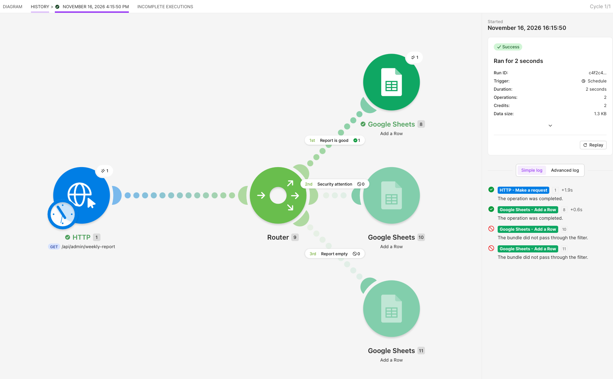
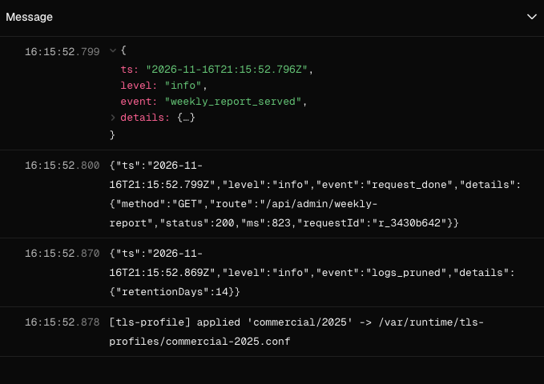
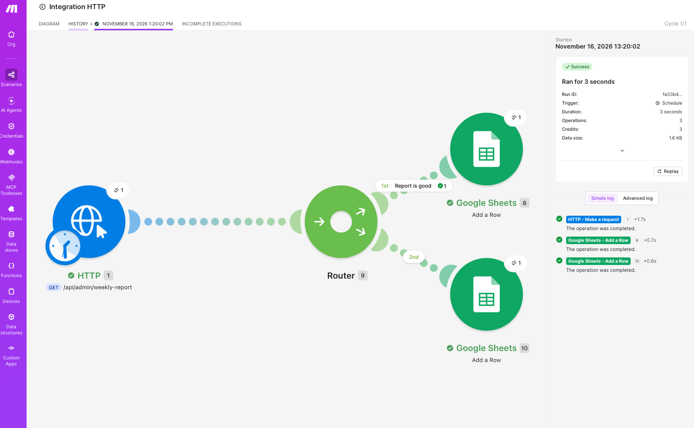

# Automation run log: the weekly app health and security report

The task: every week, MyChair's health and security numbers should land in a Google Sheet without anyone remembering to look. This is the run log of that automation, read from the Make history and from our own production logs.

## The flow (trigger, process, action)

| Step | What it is |
|---|---|
| Trigger | A Make **Schedule** (a timer). Nobody clicks anything. |
| Process | Make calls `GET /api/admin/weekly-report` on the live app with an admin API key kept in a Make keychain. The app builds one flat row from the last 7 days of its own logs: requests, errors, latency, questions answered or refused, failed logins, injection screen results, and a security status. |
| Action | A **Router** sends the row down one of three routes: **Report is good** adds a row to the `Weekly report` tab. **Security attention** (`security_status` = `attention`) and **Report empty** (HTTP status not 200, or report status not `ok`) each add a row to the `Flags` tab with the reason. |

## The real fire: Nov 16, 2026, 4:15 PM Eastern

Read from the Make run alone (screenshot below):

- **Trigger:** Schedule (shown in the run's detail panel).
- **Started:** November 16, 2026, 16:15:50. **Result:** Success, ran for 2 seconds, 2 operations.
- **HTTP step:** `GET /api/admin/weekly-report` completed (+1.9 s).
- **Router:** **Report is good** passed (1) and its Google Sheets **Add a Row** completed. **Security attention** (0) and **Report empty** (0) were blocked: "The bundle did not pass through the filter." That is the right result for a healthy report, so nothing was written to `Flags`.



## The matching line in our production logs

Vercel runtime logs for the request `GET /api/admin/weekly-report` (status 200, User Agent `Make/production`, host `mychair-eta.vercel.app`), at 4:15:52 PM Eastern, two seconds after Make's run started:

Vercel's own record of that request: environment `production`, branch `main`, `GET /api/admin/weekly-report`, status 200, User Agent `Make/production`, time to first byte 1.73 s (cold start), five SQL calls to the Neon database, request ID `g95cm-1794863751050-d6b033813413`. The log lines were written to standard output.

```json
{"ts":"2026-11-16T21:15:52.796Z","level":"info","event":"weekly_report_served","details":{…}}
{"ts":"2026-11-16T21:15:52.799Z","level":"info","event":"request_done","details":{"method":"GET","route":"/api/admin/weekly-report","status":200,"ms":823,"requestId":"r_3430b642"}}
```

The first line is the app saying it served a report (its `details` are collapsed in the Vercel view, shown as `{…}`); the second is the standard request-done line with status and milliseconds. Neither line holds the admin key. (`21:15` UTC is `4:15 PM` Eastern, since Eastern time is 5 hours behind UTC in November.)



## The earlier runs, and what they caught

The first scheduled runs were set a few minutes after the scenario was switched on, so the schedule fired while we were testing. Two of them showed real mistakes in the router, which were fixed. This is why the 4:15 PM run is the clean one.

| Time (Eastern) | Trigger | Result |
|---|---|---|
| Nov 16, 1:02 PM | Manual | First test, not counted as a real fire. |
| Nov 16, 1:20 PM | Schedule | Success, 3 operations. A second route had **no filter**, so it also wrote a false row to `Flags` (reason `security attention`) although `security_status` was `ok`. Fix: added the filter `security_status` Equal to `attention`. |
| Nov 16, 3:55 PM | Schedule | Success, 3 operations. The **Report empty** route passed when it should not have: its first condition used **Equal to** `200` instead of **Not equal to** `200`, so every healthy report (status 200) passed and wrote a false `Flags` row. Fix: changed the operator to **Numeric operators: Not equal to**. |
| Nov 16, 4:09 PM | Manual | Test of the fix: only route 1 passed. Not counted as a real fire. |
| Nov 16, 4:15 PM | Schedule | Clean run, described above. |



## What this does not show

- It is one clean scheduled fire, plus earlier scheduled fires that exposed filter mistakes. The scenario was switched off after the clean run, so it is not running weekly now, and there is no history of repeated weekly runs.
- The report is a health and warning-sign check. It does not replace `npm audit` or a real security test.
- Make keeps run history for a limited time that depends on the plan, so the screenshots in `images/` are the lasting record.
