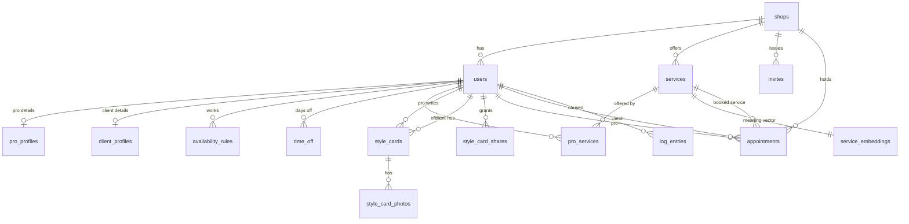

# MyChair – Data Model

Plain English: a database is a set of **tables** (like spreadsheets). Each row is one thing (one shop, one appointment). Each table has an `id`, and tables point at each other by storing the other row's id (a **foreign key**, shown as FK).

Scope: barbers, one shop. Every record that belongs to a shop still carries `shop_id`, so adding more shops later needs no redesign.

## Diagram

## Tables

Types: `uuid` = unique id, `text` = words, `int` = whole number, `timestamptz` = date and time with time zone (stored in UTC), `jsonb` = flexible structured data, `vector(1536)` = list of 1536 numbers (an embedding).

### shops
| Field | Type | Required | Notes |
|---|---|---|---|
| id | uuid | yes | primary key |
| name | text | yes | |
| timezone | text | yes | IANA name, e.g. `America/Los_Angeles`. All times shown in this zone. |
| default_booking_window_days | int | yes | default 5 |
| cancellation_window_hours | int | yes | default 2 (assumption, you haven't set this yet) |
| created_at | timestamptz | yes | |

### users (everyone who can log in)
| Field | Type | Required | Notes |
|---|---|---|---|
| id | uuid | yes | PK |
| **shop_id** | uuid FK shops | no | **Ties the user to a shop.** Empty only for `super_admin`. |
| role | text | yes | `super_admin`, `owner`, `pro`, `client` |
| name | text | yes | |
| email | text | yes | unique, used to log in. Never shown to pros. |
| phone | text | no | |
| password_hash | text | yes | hash only, never the password. Never returned by any route. |
| created_at | timestamptz | yes | |

### pro_profiles (extra fields for owner and pro users who take appointments)
| Field | Type | Required | Notes |
|---|---|---|---|
| user_id | uuid FK users | yes | PK, one row per pro. **Ties the profile to a user.** |
| station_number | text | no | set by owner |
| pay_type | text | no | `chair_rent` or `commission`. **Owner and Super Admin only.** |
| pay_amount | int | no | monthly rent in cents, or commission percent. **Owner and Super Admin only.** |
| live_status | text | yes | `available`, `with_client`, `on_break` |
| price_mode | text | yes | `standard` or `custom` |
| booking_window_days | int | no | empty means use the shop default (5). A pro can raise it. |
| bio | text | no | |

### client_profiles
| Field | Type | Required | Notes |
|---|---|---|---|
| user_id | uuid FK users | yes | PK |
| no_show_count | int | yes | strike count, default 0 |

### invites
| Field | Type | Required | Notes |
|---|---|---|---|
| id | uuid | yes | |
| **shop_id** | uuid FK shops | yes | |
| role | text | yes | `pro` (owner invites also allowed for Super Admin) |
| token_hash | text | yes | the link's secret, stored hashed |
| created_by | uuid FK users | yes | owner or Super Admin |
| expires_at | timestamptz | yes | |
| used_at / used_by | timestamptz / uuid | no | set when redeemed, so a link works once |

### services (the catalog; the "corpus" for search)
| Field | Type | Required | Notes |
|---|---|---|---|
| id | uuid | yes | |
| **shop_id** | uuid FK shops | yes | |
| name | text | yes | e.g. "Skin fade" |
| description | text | yes | e.g. "Hair tapered down to the skin on the sides" |
| default_duration_min | int | yes | |
| standard_price_cents | int | yes | the shop price list |
| active | boolean | yes | |

### service_embeddings (one row per service; the embedded count comes from here)
| Field | Type | Required | Notes |
|---|---|---|---|
| service_id | uuid FK services | yes | PK |
| embedding | vector(1536) | yes | meaning of name + description |
| model | text | yes | which embedding model made it |
| updated_at | timestamptz | yes | re-embedded when the service is edited |

### pro_services (which pro offers which service, plus custom price)
| Field | Type | Required | Notes |
|---|---|---|---|
| pro_id | uuid FK users | yes | |
| service_id | uuid FK services | yes | |
| custom_price_cents | int | no | used only when the pro's `price_mode` is `custom`. Only owner or Super Admin can set it. |

### availability_rules (weekly hours and breaks)
| Field | Type | Required | Notes |
|---|---|---|---|
| id | uuid | yes | |
| pro_id | uuid FK users | yes | |
| weekday | int | yes | 0 to 6 |
| start_time / end_time | time | yes | local time in the shop's zone |
| kind | text | yes | `work` or `break` |

### time_off
| Field | Type | Required | Notes |
|---|---|---|---|
| id | uuid | yes | |
| pro_id | uuid FK users | yes | |
| starts_on / ends_on | date | yes | days off |

### style_cards (one per pro-and-client pair)
| Field | Type | Required | Notes |
|---|---|---|---|
| id | uuid | yes | |
| **shop_id** | uuid FK shops | yes | |
| **pro_id** | uuid FK users | yes | the pro who owns the card |
| **client_id** | uuid FK users | yes | |
| preferences | jsonb | no | guard sizes, beard specs, and so on |
| notes | text | no | |
| usual_service_id | uuid FK services | no | |
| time_estimate_min | int | no | pre-filled time, used when this client books |
| | | | unique on (pro_id, client_id) |

### style_card_photos
| Field | Type | Required | Notes |
|---|---|---|---|
| id | uuid | yes | |
| style_card_id | uuid FK | yes | |
| blob_url | text | yes | the photo lives in file storage; only its address is here |
| content_type | text | yes | JPG, PNG or WebP only |
| size_bytes | int | yes | max 5 MB |

### style_card_shares (pro-to-pro permission)
| Field | Type | Required | Notes |
|---|---|---|---|
| id | uuid | yes | |
| **shop_id** | uuid FK shops | yes | |
| from_pro_id | uuid FK users | yes | owns the cards being shared |
| to_pro_id | uuid FK users | yes | may now view them |
| granted_by | uuid FK users | yes | must be owner or Super Admin |
| created_at | timestamptz | yes | |

### appointments
| Field | Type | Required | Notes |
|---|---|---|---|
| id | uuid | yes | |
| **shop_id** | uuid FK shops | yes | |
| **pro_id** | uuid FK users | yes | |
| **client_id** | uuid FK users | yes | |
| service_id | uuid FK services | yes | |
| starts_at / ends_at | timestamptz | yes | length = style-card estimate if one exists, else service default |
| status | text | yes | `waiting`, `in_chair`, `completed`, `no_show`, `cancelled` |
| payment_status | text | yes | `paid`, `deposit_held`, `cash` (record only, no real payments) |
| checked_in_at / chair_at / finished_at | timestamptz | no | |
| | | | **Double-booking guard:** a database rule rejects two active appointments for the same pro with overlapping times. |

Visit history is not its own table: it is the client's `completed` appointments with that pro.

### log_entries
| Field | Type | Required | Notes |
|---|---|---|---|
| id | uuid | yes | |
| ts | timestamptz | yes | |
| level | text | yes | debug, info, warn, error |
| event | text | yes | e.g. `request_done` |
| route | text | no | |
| shop_id / user_id | uuid | no | IDs only, never names, emails or phones |
| request_id | text | no | |
| details | jsonb | no | already redacted before saving. Deleted after 14 days. |

Metrics can also be calculated straight from `request_done` and `request_failed` rows. We keep a second, pre-counted table (below) so you can compare both approaches in the dashboard and keep the one you like best.

### metrics_minutely (pre-counted totals, one row per minute per route)
| Field | Type | Required | Notes |
|---|---|---|---|
| minute | timestamptz | yes | the start of the minute, e.g. 14:05:00 |
| route | text | yes | e.g. `/api/appointments` |
| request_count | int | yes | requests finished in that minute |
| error_count | int | yes | of those, how many failed (`request_failed`) |
| latency_sum_ms | bigint | yes | total milliseconds, so the average = sum / count |
| latency_p50_ms / latency_p95_ms | int | yes | median and 95th-percentile speed for that minute |
| | | | unique on (minute, route). Updated each time a request finishes. Deleted after 14 days like logs. |

### web_vitals
| Field | Type | Required | Notes |
|---|---|---|---|
| id | uuid | yes | |
| ts | timestamptz | yes | |
| page | text | yes | |
| metric | text | yes | LCP, INP, CLS and so on |
| value | float | yes | |
| rating | text | yes | good, needs-improvement, poor |

### Not in the database
Rate-limit counters live in Upstash Redis. Photo files live in Vercel Blob. Secrets live in environment variables.
