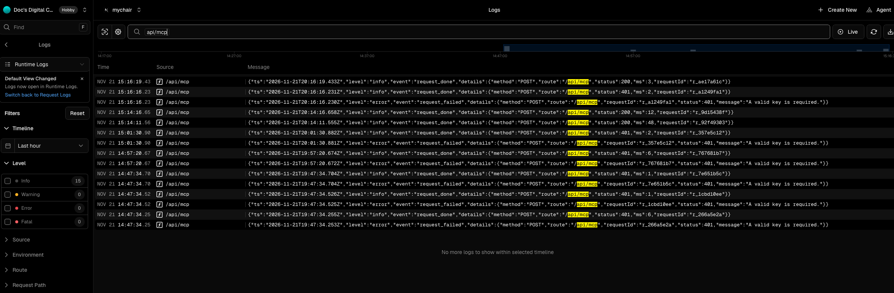

# Live MCP server: verification

The server designed in `docs/mcp-remote-design.md`, running on the live app. One tool, a real address, and the key checked before anything else.

- **Address:** `https://mychair-eta.vercel.app/api/mcp`
- **Code:** `app/api/mcp/route.ts` (order: key check, host and origin checks, then MCP), `lib/mcp-auth.ts` (the lock), `lib/mcp/health-server.ts` (the one tool)
- **Design, then code:** the design was committed first (`cce3448`), then the code (`49c8a07`), both on 2026-11-21.
- **Deployed:** pushed to `main` on 2026-11-21. Vercel built it, and the checks below ran against the production address.

## The checks, run against the live address on 2026-11-21

Each one is a `curl` request sending the MCP message `tools/list` (or `tools/call`) to the address above. The right key is read from `.env.local` inside the command and never printed.

| # | Check | Time (Eastern) | Status | Answer | Request ID |
|---|---|---|---|---|---|
| 1 | No `Authorization` header | 2:47 PM | **401** | `{"error":{"code":"UNAUTHORIZED","message":"A valid key is required."}}` | `r_1cbd10ee` |
| 2 | Wrong key (`Bearer not-the-real-key`) | 2:47 PM | **401** | Same message, no hint about how close the guess was | `r_7e651b5c` |
| 3 | Empty key (command run outside the project folder, so no key was found) | 2:57 PM | **401** | Same message | `r_767681b7` |
| 4 | Right key, `tools/list` | 3:14 PM | **200** | Exactly one tool: `get_weekly_health` | `r_92f49303` |
| 5 | Right key, `tools/call get_weekly_health` | 3:14 PM | **200** | The 7-day report (below) | `r_9d15438f` |

### The same requests in Vercel's production logs

Vercel Runtime Logs, last hour, searched for `api/mcp`. Every check above appears with its request ID and status: `r_1cbd10ee`, `r_7e651b5c` and `r_767681b7` with status 401 and `request_failed` "A valid key is required.", then `r_92f49303` and `r_9d15438f` with status 200. No line holds a key.



The screenshot has four more lines than the table, all from the same session: `r_266a5e2a` (2:47 PM, 401) was the first no-key probe sent while waiting for the deploy to finish; `r_357e5c12` (3:01 PM, 401) was a no-key attempt run from outside the project folder; `r_a1249fa1` (3:16 PM, 401) and `r_ae17a61c` (3:16 PM, 200) are the wrong-key call and the tool call used to prove the failure count (below). The `mcp_auth_failed` and `mcp_tool_called` lines don't show in this view because they carry no route text for the `api/mcp` search to match; they are proved by the report's counts instead.

A 401 (not a 503) on checks 1 to 3 also proves the server has its `MCP_API_KEY` set: with no key configured, it answers 503 "not available" to everyone.

### Check 4: the tool list (exactly one tool)

```json
{"result":{"tools":[{"name":"get_weekly_health","description":"Get MyChair's health and security report for the last 7 days: requests, server errors, latency, questions answered or refused, failed key attempts, injection-screen hits, and an overall status and security status. Counts only, no personal data. Read-only.","inputSchema":{"type":"object","$schema":"https://json-schema.org/draft/2020-12/schema","properties":{}}}]},"jsonrpc":"2.0","id":1}
```

### Check 5: the tool's answer (counts only)

```json
{
  "status": "ok",
  "week_start": "2026-11-14",
  "week_end": "2026-11-21",
  "generated_at": "2026-11-21T20:14:16.654Z",
  "requests": 26,
  "server_errors_5xx": 0,
  "error_rate_pct": 0,
  "p50_ms": 97,
  "p95_ms": 2086,
  "questions_asked": 5,
  "answered": 3,
  "refused": 2,
  "bad_requests_400": 0,
  "unauthorized_401": 6,
  "forbidden_403": 0,
  "too_many_429": 0,
  "auth_failures": 6,
  "injection_blocked": 0,
  "cap_hits": 0,
  "corpus_chunks": 118,
  "corpus_chunks_flagged": 0,
  "admin_key_set": true,
  "anthropic_key_set": true,
  "log_level_ok": true,
  "logging_alive": true,
  "security_status": "ok",
  "security_notes": "auth_failures_some"
}
```

No names, emails, phone numbers, typed questions or keys: only counts, dates and `ok`/`attention` words.

**The failed attempts were recorded.** Each rejected call writes an `mcp_auth_failed` line to the production log table, and the report counts those together with wrong admin keys. To prove it rather than assume it, one more wrong-key call was sent at 3:16 PM (401), and the tool was called again straight after: `auth_failures` went from **6 to 7** and `unauthorized_401` from **6 to 7**. Ten in a week would turn `security_status` to `attention`.

## The dangerous tool, never built

No tool reads raw log lines or client records, and no tool writes, deletes or runs SQL. The server registers one tool, and check 4 shows the live tool list has exactly one entry. The reasoning is in `docs/mcp-remote-design.md`.

## Automated tests (`npm test`)

- `lib/mcp-auth.test.ts`: right key opens; missing, wrong and malformed keys get 401; the admin key header does not open it; no `MCP_API_KEY` on the server means 503 for everyone.
- `lib/mcp/health-server.test.ts`: real MCP messages through the same handler the route uses; exactly one tool listed; only the 27 allowed fields come back; a database failure gives a friendly error with no details; an unknown tool (`read_logs`) is refused.
