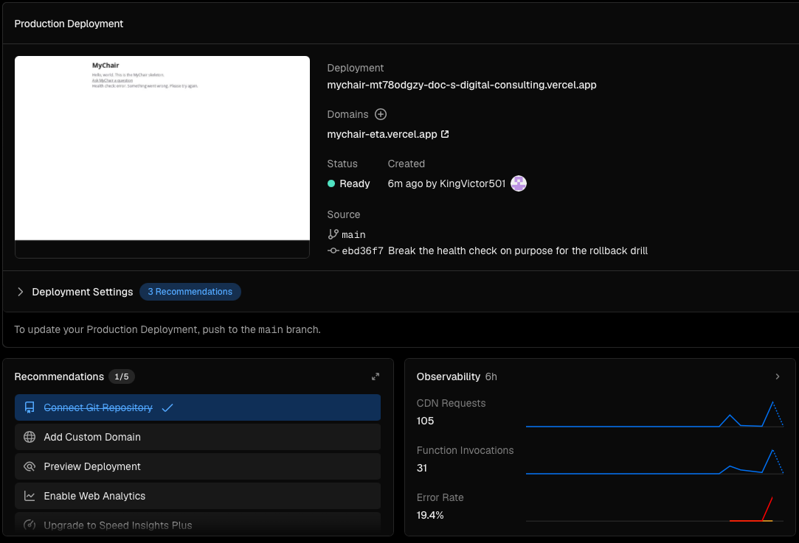
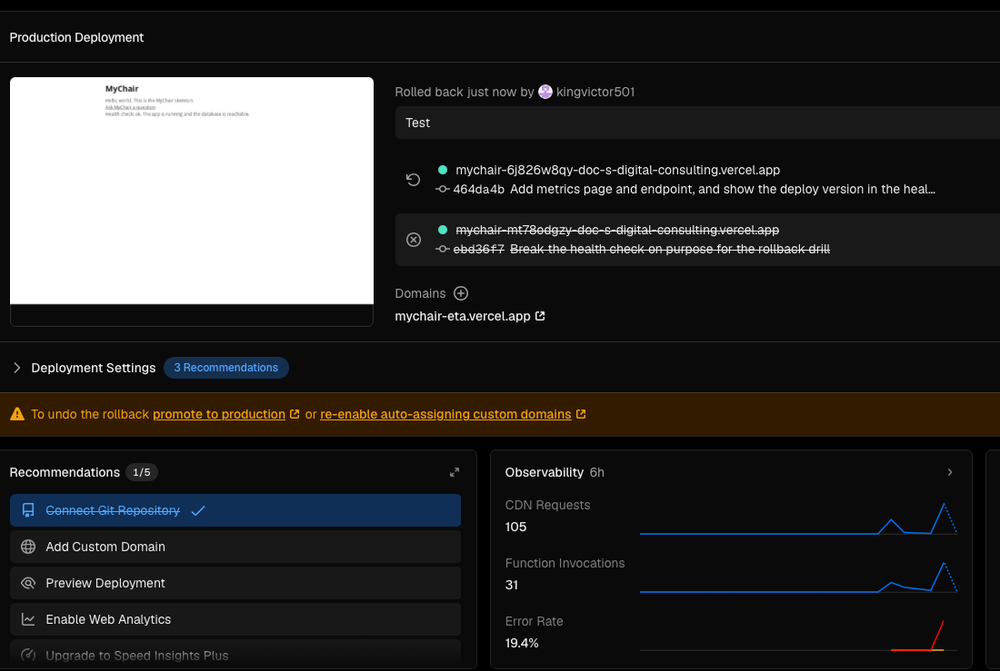
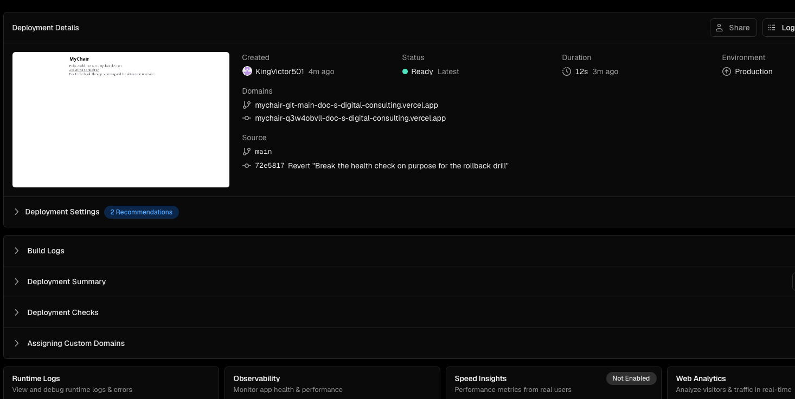

# Observability: logs, metrics, answer checks and rollback

How I know MyChair is working in production, how I find out when it isn't, and how I put it back.

- **Live app:** https://mychair-eta.vercel.app
- **Which deploy is live:** `GET /api/health` returns `{"status":"ok","version":"<commit>"}`. The version is the first 7 characters of the git commit Vercel built (`VERCEL_GIT_COMMIT_SHA`).

## Logs

Every API route is wrapped by `lib/with-logging.ts`, which writes structured JSON lines: `request_done` (method, route, status, milliseconds, request ID) for every request, and `request_failed` (route, status, cleaned message) for every error. Every line goes through the redaction helper (`lib/redact.ts`), so passwords, tokens, keys, emails and phone numbers never reach a log.

Lines go to two places:

| Where | Kept for | Used for |
|---|---|---|
| Vercel runtime logs | 1 hour (Hobby plan) | Watching a request live; searching by route or request ID |
| `log_entries` table in Neon | 14 days | The metrics page, the weekly health report, the MCP tool and the triage agent |

The `x-request-id` header on every response matches the `requestId` in the log lines, so one request can be followed from the browser to the logs.

## Metrics

`/metrics` (admin key required) shows, for the last hour, 24 hours or 7 days:

- summary numbers: requests, server errors and error rate, median (p50) and slowest-5% (p95) response time;
- three charts over time: requests, server errors (status 500 or more), and response time (p50 and p95).

The numbers come from `GET /api/admin/metrics`, which reads the `request_done` lines in `log_entries` (`lib/metrics-data.ts`). Quiet periods show as zero instead of gaps. Each chart has a hover tooltip and a "Show as table" view.

Vercel's own Observability tile (requests, function invocations, error rate) is a second view of the same traffic, but it can't be filtered by my routes or kept past the plan's limits, so the metrics page is the one I rely on.

## Checking the AI's answers before they're shown

The public Ask page (`/ask`) never shows Claude's reply as-is. `lib/rag.ts` and `lib/ask.ts` check it first:

- The reply must follow the answer format: the answer, then a `Source:` line. A reply that breaks the format is treated as `malformed` and not shown.
- **Every citation must match a passage that was actually retrieved** for that question (`citationsMatchPassages`). An answer citing a document or section that wasn't in the retrieved passages is not shown.
- If either check fails, the answer is withheld: `/api/ask` returns 502 `ANSWER_UNVERIFIED` with "I couldn't produce a verified answer. Please try rephrasing your question." The engine's `rag_answer` log line records the outcome and `citationsVerified: false`, and the 502 appears as a server error on the metrics page.

The question itself is screened for prompt injection before it reaches the model (`lib/injection.ts`), and its length is capped with `zod`.

## Rollback drill: 2026-11-21

A practiced rollback on production, using Vercel's Instant Rollback. All times are UTC (Eastern is 5 hours behind).

| Time (UTC) | What happened | Proof |
|---|---|---|
| 20:58:01 | **Good deploy A** live: commit `464da4b` (metrics page) | `/api/health` → `{"status":"ok","version":"464da4b"}` |
| 20:58:33 | **Bad deploy B** pushed and live: commit `ebd36f7` makes `/api/health` throw on purpose | `/api/health` → **500** `{"error":{"code":"INTERNAL_ERROR","message":"Something went wrong. Please try again."}}` (request IDs `r_e835eab8`, `r_31a5e9ca`, `r_1b5d809f`). No stack trace was shown. |
| about 21:05 | **Instant Rollback** in the Vercel dashboard: Production Deployment tile, **Instant Rollback**, previous deployment `464da4b`, **Confirm Rollback** | Screenshot 2 below. `ebd36f7` is crossed out. |
| 21:08:57 | Recovery confirmed | `/api/health` → `{"status":"ok","version":"464da4b"}` (`r_4072eb77`, `r_2d402f72`, `r_c2468b99`) |
| 21:09 | Fix pushed: commit `72e5817` reverts the bad commit. After a rollback Vercel doesn't promote new pushes automatically, so it waited. | |
| 21:13 | **Promoted** `72e5817` from the dashboard banner ("To undo the rollback **promote to production**"), which also turned normal deploys back on | `/api/health` → `{"status":"ok","version":"72e5817"}` (`r_cb997d43`, `r_eb4979ce`) |

**The symptom:** the home page's health line read "Health check: error. Something went wrong. Please try again." and `/api/health` returned 500 with a safe message.

**How it showed up in monitoring:**

- The metrics page on production (`/api/admin/metrics?range=1h`) showed **6 server errors in the hour, all in the 20:58 and 20:59 minutes** (4 of 8 requests at 20:58, 2 of 2 at 20:59) and none before or after.
- Vercel's Observability tile showed the error rate jump to 19.4% (screenshot 1).

**Time to recover:** the rollback itself was instant once confirmed. From the bad deploy going live to the app answering correctly again took about 10 minutes, most of it the time to reach the dashboard. The permanent fix (revert and promote) was live 15 minutes after the bad deploy.

**What I learned:** after an Instant Rollback, Vercel stops auto-promoting pushes to `main`. The fix has to be promoted by hand, or the next "fix" push silently never goes live. On my screen the undo was a banner link (**promote to production**), not the **Manage** button the docs describe.

