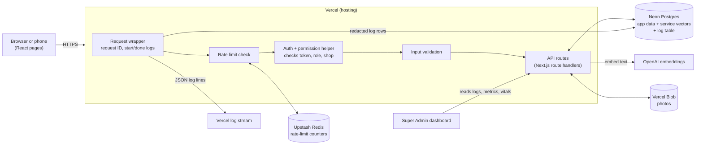
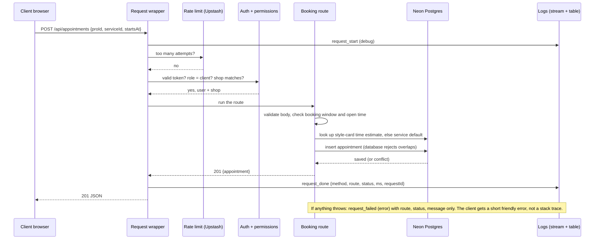
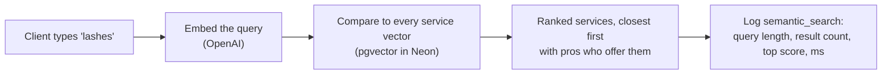

# MyChair – System Diagram

## The big picture

## One request, start to finish: a client books an appointment

## One search request: query to ranked results

## Where each safety layer sits
| Layer | What it does |
|---|---|
| Request wrapper | Gives every request an ID and logs its edges once, for all routes. |
| Rate limit | Stops floods on login, sign-up, booking, and search. |
| Auth + permission helper | One shared function reads `docs/permissions.md` rules: role and shop, on the server. |
| Validation | Rejects bad input before it touches the database. |
| Log redaction | Strips passwords, tokens, emails, phones from log details before they are saved anywhere. |
| Database | Final guard: foreign keys and the no-overlap rule for appointments. |
